

  

  
  &nbsp;
  

I am a final-year engineering student in **Digital Transformation & AI** at **ENSA Al Hoceima**, after two years of preparatory classes (CPGE, MPSI). I like turning raw data and language models into something a team can act on: a clear dashboard, a measured funnel, a fine-tuned model.

- 🎯 **Looking for:** an end-of-studies internship (PFE) in **Data & AI / LLM engineering**.
- 🤝 **How I work:** mostly in small teams. Each project below says what the team built and, when it applies, what my part was.

<table>
<tr><td width="50%" valign="top">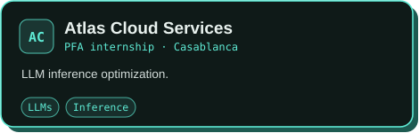</td><td width="50%" valign="top">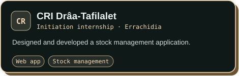</td></tr>
</table>

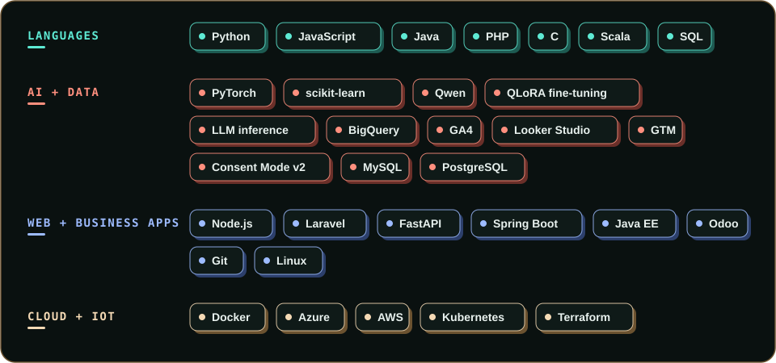

<table>
<tr><td width="50%" valign="top"><a href="https://github.com/yassirHam/MedicalChatbot_DeepLearning">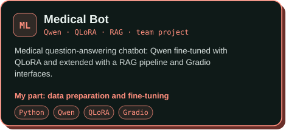</a></td><td width="50%" valign="top"><a href="https://github.com/Moaad-Daoudi/ai-log-anomaly-detector">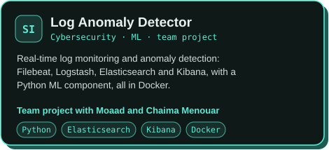</a></td></tr>
<tr><td width="50%" valign="top"><a href="https://github.com/yassirHam/gestion-PFE">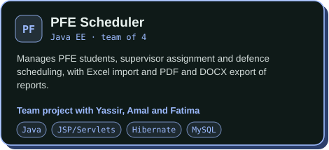</a></td><td width="50%" valign="top"><a href="https://github.com/chaima-menouar/ga4-ecommerce-marketing-analytics">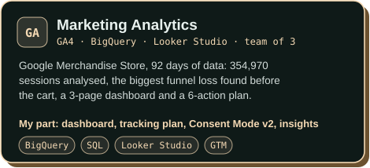</a></td></tr>
</table>

<table>
<tr><td width="50%" valign="top"><a href="https://github.com/chaima-menouar/job-intelligent">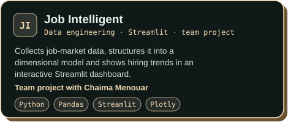</a></td><td width="50%" valign="top"><a href="https://github.com/Siham2014/odoo-multivendor-ecommerce-marketplace">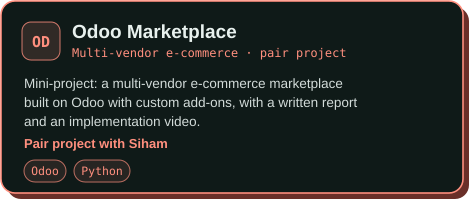</a></td></tr>
<tr><td width="50%" valign="top"><a href="https://github.com/ouhadi02/Water-Level-Monitoring-System">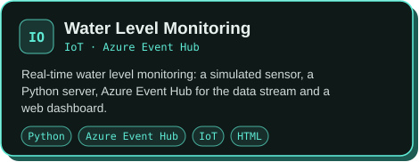</a></td><td width="50%" valign="top"><a href="https://github.com/ouhadi02/Gestion-des-tickets-d-un-zoo">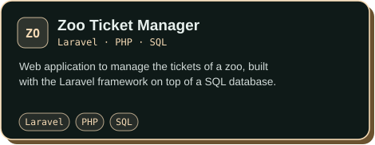</a></td></tr>
<tr><td width="50%" valign="top"><a href="https://github.com/ouhadi02/Mini-App-NodeJS">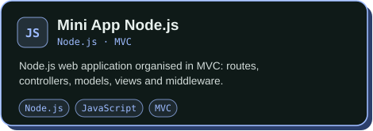</a></td><td width="50%" valign="top"><a href="https://github.com/ouhadi02?tab=repositories">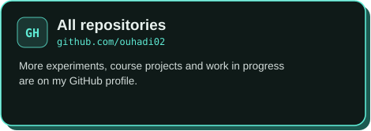</a></td></tr>
</table>

Internships, collaborations or questions about any project: write to me at [ouhadi.chaimae@etu.uae.ac.ma](https://mail.google.com/mail/?view=cm&fs=1&to=ouhadi.chaimae@etu.uae.ac.ma) or message me on [LinkedIn](https://www.linkedin.com/in/ouhadi-chaimae).

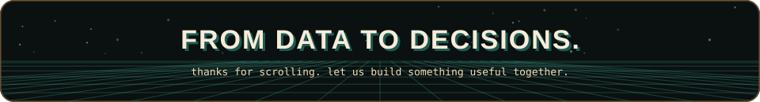
